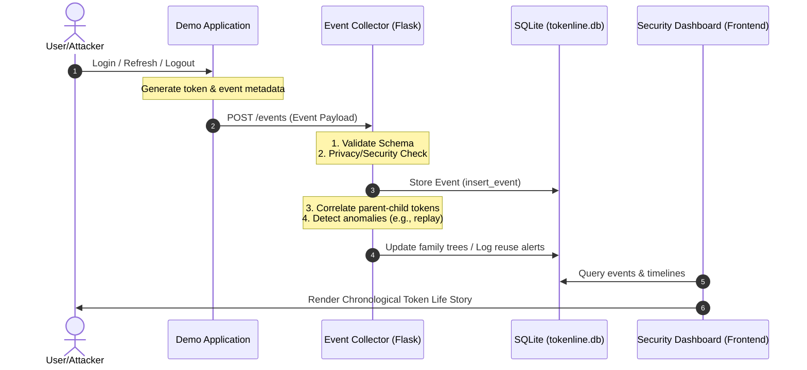

# TokenLine: System Flow and Architecture Guide

This document explains the comprehensive data flow, storage mechanism, user interface rendering, and component interaction of the **TokenLine** project.

---

## 1. System Architecture Overview

TokenLine operates as a lightweight, real-time correlation and monitoring framework. It intercepts session lifecycle events from an identity provider or application and visualizes them on a unified security timeline.

---

## 2. Component Explanations

### A. Demo Application (`demo-app`)
*   **Purpose:** Simulates an Identity Provider (IdP) or client-facing application.
*   **How it Works:** 
    *   Exposes endpoints for user login, token refresh, and logout.
    *   Generates access tokens and refresh tokens.
    *   Utilizes the client-side component [`eventService.js`](file:///d:/5sem/TokenLine/TokenLine/demo-app/src/services/eventService.js) to build event metadata on every user action.
    *   Sends these metadata payloads asynchronously via HTTP POST requests to the Event Collector.
    *   *Security Practice:* It never transmits raw passwords or active tokens. Instead, it generates and transmits privacy-preserving hashes (`token_hash`) of those tokens.

### B. Event Collector (`backend/collector`)
*   **Purpose:** Receives, sanitizes, validates, and correlates raw event data.
*   **How it Works:**
    1.  **Ingestion:** Listens for incoming POST requests at `/events` in [`app.py`](file:///d:/5sem/TokenLine/TokenLine/backend/collector/app.py).
    2.  **Schema Validation:** Validates the payload structure against the JSON schema defined in [`event.schema.json`](file:///d:/5sem/TokenLine/TokenLine/schema/event.schema.json).
    3.  **Security Sanitization:** Inspects the request using `contains_raw_credentials()`. If a raw JWT token pattern or Authorization Bearer header is discovered in the payload, the server rejects the request immediately with a `400 Bad Request` to prevent sensitive credentials leakage in logs.
    4.  **Database Storage:** Stores the event in SQLite.
    5.  **Real-Time Correlation & Detection:** Invokes the unified correlator engine [`engine.py`](file:///d:/5sem/TokenLine/TokenLine/backend/correlator/engine.py) to update the token lineage trees and flags security anomalies.

---

## 3. Data Storage Model (`tokenline.db`)

The project uses SQLAlchemy to organize and query data within three tables:

### 1. `events` Table
Stores raw metadata records of what occurred in the system.
*   `event_id`: Unique identifier (e.g., `evt-001`).
*   `event_type`: Lifecycle state (`token_issued`, `token_used`, `token_refreshed`, `token_revoked`, `token_expired`, `replay_detected`).
*   `time`: UTC timestamp.
*   `token_hash`: Privacy-preserving identifier for the token.
*   `parent_token_hash`: If refreshed, links back to the token that was rotated.
*   `ip_hash` / `country` / `device_id`: Client context.
*   `result`: `accepted` or `rejected`.

### 2. `token_family_members` Table
Maintains the relational hierarchy of token family branches to trace rotation paths.
*   `token_hash`: The unique token identifier.
*   `token_family`: The group identifier (e.g., `family-khushi-1`).
*   `parent_token_hash`: Parent node in the rotation chain.
*   `is_rotated`: Boolean indicating if this refresh token was already used to issue a new one.
*   `superseded_by`: Holds the child token's hash after rotation.

### 3. `token_reuse_records` Table
Tracks alerts and security warnings.
*   `token_hash`: The rotated token that was illegally reused.
*   `token_family`: The family affected.
*   `attempted_event_id`: The event ID that triggered the reuse alert.

---

## 4. UI Dashboard Visualization (`frontend/dashboard`)

The dashboard UI renders the token story using frontend controllers:
1.  **Timeline Reconstruction:** 
    *   The frontend queries backend APIs to retrieve event histories.
    *   It traces the parent/child relationships between tokens to reconstruct the chain of rotation.
2.  **Visual Representation:**
    *   It shows a chronological timeline mapping when a token was **Issued**, **Used**, **Refreshed (Rotated)**, and **Expired/Revoked**.
3.  **Explainable Anomaly Alerts:**
    *   If a rotated refresh token is used a second time, the timeline marks the exact reuse point in **red** with a severity warning (e.g. *Critical: Refresh Token Reuse*).
    *   It lists the evidence details (previous rotation time vs. reuse attempt time, location/device shifts) so a security analyst can evaluate the attack flow.
