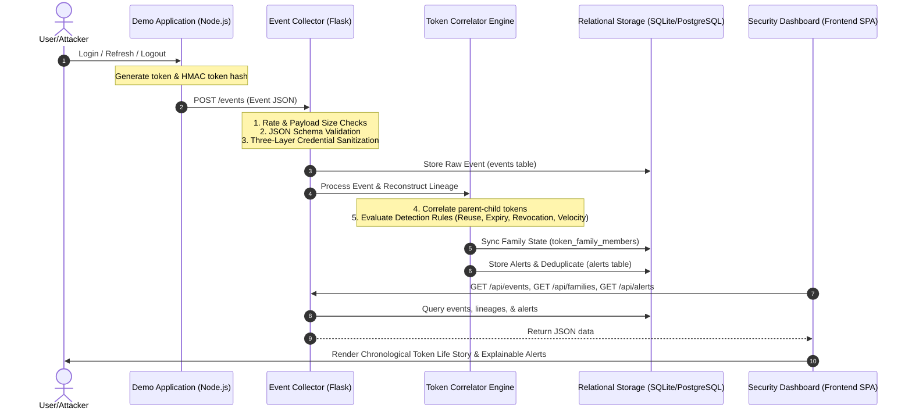

# TokenLine: System Flow and Architecture Guide

This document explains the comprehensive data flow, storage mechanisms, user interface rendering, and component interactions of the **TokenLine** platform.

---

## 1. System Architecture Overview

TokenLine operates as a lightweight, real-time token lifecycle correlation and monitoring framework. It captures authentication lifecycle events from a demo application or synthetic attack simulator, normalizes and correlates those events into token families, evaluates detection rules, and visualizes the complete lifecycle on an investigable security timeline.

---

## 2. Component Explanations

### A. Demo Application (`demo-app/`)
* **Purpose:** Simulates an Identity Provider (IdP) or client-facing web application.
* **How it Works:** 
  * Exposes REST endpoints for user authentication: `/auth/login`, `/auth/refresh`, and `/auth/logout`.
  * Issues JSON Web Tokens (JWT) for access and cryptographically secure random values for refresh tokens.
  * Uses [`demo-app/src/services/eventService.js`](demo-app/src/services/eventService.js) to build event metadata on every user action.
  * Dispatches event payloads asynchronously via HTTP POST requests to the Event Collector (`POST /events`).
  * **Privacy Guarantee:** Never transmits raw passwords or active tokens. It computes and transmits a keyed HMAC-SHA-256 hash (`token_hash`) using `TOKEN_HMAC_SECRET`.

### B. Event Collector (`backend/collector/`)
* **Purpose:** Ingests, sanitizes, validates, and stores incoming security event telemetry.
* **How it Works:**
  1. **Payload Size Guard:** Rejects requests exceeding 10 MB with HTTP 413.
  2. **Role-Based Authentication:** Authenticates callers using constant-time comparisons (`admin`, `ingest`, `read`).
  3. **Schema Validation:** Validates the structure against [`schema/event.schema.json`](schema/event.schema.json).
  4. **Three-Layer Credential Protection:**
     - *Layer 1 (Structural Validation):* Enforces that hash fields match hexadecimal or `hash_` formats.
     - *Layer 2 (Pattern Detection):* Scans strings for JWT formats (`ey...`), Bearer headers, and credential assignments.
     - *Layer 3 (High-Entropy Detection):* Calculates Shannon entropy across continuous string chunks to detect high-entropy credentials that bypass regex patterns.
     - Payloads containing raw credentials are immediately rejected with HTTP 400 Bad Request.
  5. **Persistence:** Saves valid events into the database.
  6. **Correlation & Detection:** Passes events to `backend/correlator/engine.py` to update the token state machine and trigger alerts.

### C. Unified Correlation Engine (`backend/correlator/`)
* **Purpose:** Reconstructs token lineage trees and detects security anomalies in real time.
* **How it Works:**
  * Tracks token lifecycle states: `ACTIVE`, `ROTATED`, `REUSED`, `REVOKED`, `EXPIRED`.
  * Traverses parent-child links (`reconstruct_chain`) from root tokens to current leaves.
  * Evaluates five detection rules:
    - `RULE-TOKEN-REUSE` (Refresh-token reuse on rotated parent tokens)
    - `RULE-REVOKED-USE` (Post-revocation token usage)
    - `RULE-EXPIRED-USE` (Post-expiration token usage)
    - `RULE-CONCURRENT-USE` (Simultaneous usage from distinct devices or IPs within 60s)
    - `RULE-IMPOSSIBLE-TRAVEL` (Velocity anomalies between distinct countries within 300s)
  * Generates deduplicated `AlertRecord` objects with explainable evidence and unique fingerprint hashes.

---

## 3. Data Storage Model

TokenLine manages storage via SQLAlchemy with automated database migrations ([`backend/database/migrations.py`](backend/database/migrations.py)):

### 1. `events` Table
Stores raw metadata records of observed system actions:
* `event_id`: Unique identifier (e.g., `evt-001`).
* `event_type`: Lifecycle action (`token_issued`, `token_used`, `token_refreshed`, `token_revoked`, `token_expired`, `logout`, etc.).
* `time`: Normalized UTC ISO-8601 timestamp.
* `user_id`: Target subject identifier.
* `token_hash`: Keyed HMAC or synthetic hash representing the token.
* `token_family`: Token family identifier grouping related rotation generations.
* `parent_token_hash`: Predecessor token rotated during refresh.
* `ip_hash` / `country` / `device_id` / `user_agent_family`: Contextual client telemetry.
* `endpoint`: Target API route accessed.
* `result`: `accepted` or `rejected`.
* `schema_version`, `source`, `is_simulation`: Traceability metadata.

### 2. `token_family_members` Table
Tracks rotation chains and current statuses of individual tokens within a family:
* `token_hash` (PK): The unique token identifier.
* `token_family`: The group identifier (indexed).
* `parent_token_hash`: Parent node in the rotation chain.
* `is_rotated`: Boolean indicating if this token was retired upon refresh.
* `rotated_at`: UTC timestamp of rotation.
* `superseded_by`: Hash of the child token issued to replace this token.
* `user_id`: Associated user identifier.

### 3. `token_reuse_records` Table
Tracks refresh-token reuse violations:
* `id` (PK): Auto-incrementing identifier.
* `token_hash`: The rotated token that was illegally reused.
* `token_family`: The affected family.
* `reused_at`: Timestamp of the reuse attempt.
* `attempted_event_id`: The event ID that triggered the alert.
* *Constraint:* `UNIQUE (token_hash, attempted_event_id)` ensures idempotent alerting upon log replay.

### 4. `scenario_executions` Table
Tracks simulation and scenario execution metadata:
* `id` (PK): Unique execution identifier.
* `scenario_name`: Name of the executed scenario (`refresh-reuse`, `normal`, etc.).
* `started_at` / `completed_at`: Execution timing.
* `status`: `started`, `completed`, or `failed`.
* `event_count`: Number of events processed.
* `error_message`: Error details if failed.

### 5. `alerts` Table
Standardized alert store populated by the detection engine:
* `id` (PK): Unique alert identifier (`alert-...`).
* `rule_id`: Canonical rule identifier (e.g., `RULE-TOKEN-REUSE`).
* `severity`: Alert severity (`critical`, `high`, `medium`, `low`).
* `status`: Lifecycle status (`open`, `acknowledged`, `resolved`).
* `timestamp`: UTC detection timestamp.
* `title`: Human-readable summary.
* `explanation`: Detailed rationale explaining why the alert was generated.
* `event_refs_json`: Associated event IDs.
* `token_family_id` / `token_hash` / `user_id`: Affected entities.
* `evidence_json`: Sanitized, redacted forensic evidence supporting the alert.
* `dedup_fingerprint`: SHA-256 fingerprint enforcing idempotency.
* *Constraint:* `UNIQUE (dedup_fingerprint)`.

---

## 4. Security Investigation Frontend

The Single-Page Application ([`frontend/index.html`](frontend/index.html)) provides three visualization layers:

1. **Chronological Session Timeline**:
   * Displays events sequentially in UTC.
   * Color-codes accepted events vs rejected actions and alerts.
2. **Dynamic SVG Lineage Tree**:
   * Visualizes rotation chains ($T_1 \rightarrow T_2 \rightarrow T_3$).
   * Badges tokens with current state (`ACTIVE`, `ROTATED`, `REUSED`, `REVOKED`, `EXPIRED`).
   * Renders red warning indicators on nodes where reuse was attempted.
3. **Interactive 3D Canvas Globe**:
   * Renders geographic paths connecting successive authentication events.
   * Visualizes impossible travel velocities with animated arcs between distant coordinates.
4. **Explainable Alert Drawer**:
   * Clicking an alert or flagged node displays the exact forensic evidence (time delta, conflicting devices/IPs, prior rotation timestamp).
