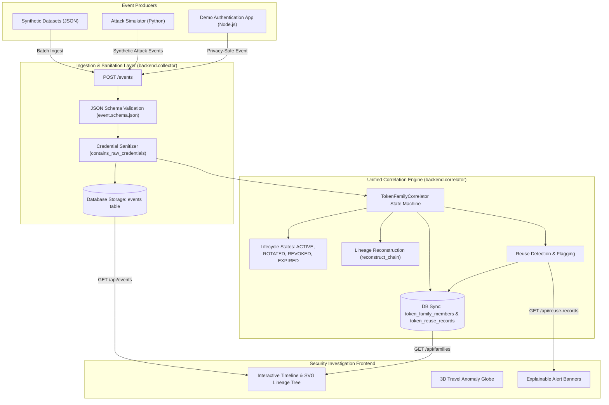

# TokenLine — Complete Project Onboarding & Training Guide

Welcome to **TokenLine**! This training guide gives you an end-to-end mental map of the entire repository. Read through this guide to understand how authentication events travel from demo apps and synthetic simulators, through security sanitizers, into the unified lifecycle correlation engine, and onto the visual interactive dashboard.

---

## 1. What This Project Is

TokenLine is an authentication-token lifecycle correlation and visual security analysis platform. Traditional authentication servers only know when a token is issued or expired, while SIEMs store fragmented logs. TokenLine solves this gap by connecting scattered authentication events into one continuous, visual story of a token's entire life. Security analysts and developers use TokenLine to inspect token rotation chains, observe parent-child token lineage, detect refresh token reuse attacks, and catch anomalous sessions.

---

## 2. Tech Stack

| Technology | Role | Why It Is Used Here |
| :--- | :--- | :--- |
| **Python 3.12+** | Backend Runtime | Clean, expressive language for security logic, schema validation, and state machines. |
| **Flask 3.1.3** | Web API Framework | Lightweight REST API server hosting the Event Collector and serving static assets. |
| **SQLAlchemy 2.0.52** | ORM & DB Abstraction | Robust database toolkit providing unified schema models and query abstractions across SQLite and PostgreSQL. |
| **SQLite / PostgreSQL** | Storage Layer | SQLite provides instant, zero-setup local storage; PostgreSQL (via Neon) supports scalable deployments. |
| **jsonschema 4.26.0** | Payload Validation | Enforces strict contract validation on every incoming event against `schema/event.schema.json`. |
| **Node.js & Express** | Demo Application | Simulates a real-world web service generating live login, token rotation, and API traffic. |
| **JSON Web Tokens (JWT)**| Demo App Auth | Standard industry access tokens used in the sample authentication service. |
| **Vanilla JavaScript (ES6)** | Frontend Engine | High-performance, dependency-free interactive UI running the timeline, SVG lineage tree, and 3D globe. |
| **Vanilla CSS** | Styling System | Curated dark-mode design system with design tokens (`tokens.css`) without heavyweight CSS frameworks. |
| **Pytest 9.1.1** | Test Suite | Automated testing for unit logic, database migrations, state machines, and attack simulation scenarios. |

---

## 3. Folder Map

```text
TokenLine/
├── backend/                  # Core Python backend services
│   ├── collector/            # Event Collector HTTP server and API endpoints
│   │   ├── __init__.py       # Collector package exports (app, create_app, db helpers)
│   │   ├── app.py            # Flask REST API handling /events, /api/families, etc.
│   │   └── db.py             # SQLAlchemy models (Event, TokenFamilyMember, TokenReuseRecord)
│   ├── correlator/           # Unified Token Family Correlation Engine
│   │   ├── __init__.py       # Correlator package exports and module helpers
│   │   ├── engine.py         # TokenFamilyCorrelator state-machine & lineage builder
│   │   ├── models.py         # In-memory domain models (TokenRecord, TokenStatus, TokenReuseRecord)
│   │   └── README.md         # Architecture and usage documentation for the correlator
│   └── database/             # Database migrations & version manager
│       ├── __init__.py       # Exports MigrationManager and run_migrations
│       └── migrations.py     # Schema migrations (indexes, constraints, UTC normalization)
├── data/
│   └── synthetic/            # Offline attack datasets and scenario event streams
├── demo-app/                 # Complete Node.js/Express demo authentication service
│   ├── src/
│   │   ├── middleware/auth.js# JWT verification and route guard middleware
│   │   ├── routes/auth.js    # /login, /refresh, /logout endpoints
│   │   ├── services/         # Token, session, and event emitter services
│   │   └── utils/tokenId.js  # Privacy-preserving HMAC token hashing
│   └── package.json          # Node.js dependencies and test runner
├── docs/                     # Research and system architecture documentation
├── frontend/                 # Static interactive dashboard
│   ├── css/                  # Curated dark-mode stylesheets (main.css, tokens.css)
│   ├── js/                   # UI controllers, SVG lineage renderer, and 3D canvas globe
│   │   ├── app.js            # Main SPA router and view coordinator
│   │   ├── data.js           # Scenario definitions, schema specs, and offline datasets
│   │   ├── diagram.js        # Dynamic SVG parent-child lineage tree renderer
│   │   └── globe.js          # Interactive 3D Canvas coordinate globe for travel anomaly viz
│   └── index.html            # Main single-page application entry point
├── schema/
│   └── event.schema.json     # Strict JSON Schema defining valid security events
├── simulator/                # Deterministic synthetic attack generator
│   ├── base.py               # Base scenario generator with pseudo-random seed control
│   ├── runner.py             # CLI and programmatic scenario execution runner
│   ├── concurrent-use/       # Scenario: Token presented simultaneously from multiple devices
│   ├── impossible-travel/    # Scenario: Token used across distant continents in minutes
│   ├── refresh-reuse/        # Scenario: Rotated refresh token replayed by adversary
│   ├── replay/               # Scenario: Intercepted token reused on unauthorized host
│   └── revoked-token/        # Scenario: Token presented after explicit user logout
├── tests/
│   ├── scenarios/            # Integration tests running simulated attack streams
│   └── unit/                 # Unit tests for collector, correlator, migrations, and UI rules
├── pytest.ini                # Cross-platform test configuration (pythonpath = .)
└── requirements.txt          # Python dependencies
```

---

## 4. Big Picture Architecture

The TokenLine system works like a security surveillance hub with three interconnected layers:
1. **The Producers**: Live Demo Apps and Attack Simulators emit privacy-safe event metadata.
2. **The Ingestion & Correlation Core**: The Flask Collector validates payloads, rejects raw credentials, stores events, and feeds the `TokenFamilyCorrelator` state machine.
3. **The Investigation UI**: The dashboard queries token families, reconstruction chains, and security alerts to draw intuitive interactive timelines.



---

## 5. How to Run It

### Prerequisites
- Python 3.12+
- Node.js 18+ (for demo-app)

### Step 1: Install Python Dependencies
```bash
pip install -r requirements.txt
```
*Verification*: Run `python -c "import flask, sqlalchemy, jsonschema; print('Python OK')"`

### Step 2: Start the Event Collector & API
```bash
python -m backend.collector.app
```
*Verification*: Open `http://127.0.0.1:5000` in your browser. You will see the TokenLine dashboard.

### Step 3: Run the Attack Simulator
In a separate terminal, trigger any simulated attack scenario:
```bash
python -m simulator.runner --scenario refresh-reuse --submit
```
*Verification*: Terminal prints `Successfully submitted 5 events to http://127.0.0.1:5000/events`. Refreshing `http://127.0.0.1:5000` shows the detected reuse alert in the UI!

### Step 4: Run Automated Tests
```bash
python -m pytest -v
```
*Verification*: All 44 automated tests pass cleanly with green checkmarks.

---

## 6. Walkthrough of the Main Flows

### Flow 1: User Login & Token Issuance
1. **User Action**: A user logs in at `demo-app/src/routes/auth.js`.
2. **Demo App Processing**: The service creates an access JWT and an opaque refresh token. Before storing or sending anything, [`tokenId.hashToken()`](file:///d:/5sem/TokenLine/TokenLine/demo-app/src/utils/tokenId.js#L16) hashes the refresh token using HMAC-SHA256.
3. **Event Emission**: `demo-app/src/services/eventService.js` sends a `token_issued` event to `POST http://127.0.0.1:5000/events`.
4. **Collector Validation**: `backend/collector/app.py` validates the schema against `schema/event.schema.json` and runs `contains_raw_credentials()`.
5. **Correlation**: `backend/correlator/engine.py` registers the new token with status `TokenStatus.ACTIVE` in a new or existing token family.
6. **Storage**: The event is saved to `events` and synced to `token_family_members`.

### Flow 2: Token Refresh & Rotation
1. **User Action**: The client presents their current refresh token to `/api/auth/refresh`.
2. **Rotation**: The demo app issues new child token $T_2$ and retires parent token $T_1$.
3. **Event Emission**: Emits `token_refreshed` with `parent_token_hash: hash(T_1)` and `token_hash: hash(T_2)`.
4. **Correlator State Transition**:
   - $T_1$ transitions from `ACTIVE` to `ROTATED` (`is_rotated = True`, `superseded_by = hash(T_2)`).
   - $T_2$ is registered as `ACTIVE` with `parent_token_hash = hash(T_1)`.
5. **Lineage**: The correlator establishes the ancestor-descendant link $T_1 \rightarrow T_2$.

### Flow 3: Refresh-Token Reuse Attack (The Threat Scenario)
1. **Adversary Action**: An attacker steals the old, retired token $T_1$ and attempts to refresh it.
2. **Event Emission**: A `token_refreshed` event arrives presenting `parent_token_hash: hash(T_1)`.
3. **Detection**:
   - `TokenFamilyCorrelator.process_event()` inspects $T_1$.
   - $T_1$ is already `ROTATED`, and its recorded successor is $T_2$ (not the attacker's request).
   - The engine immediately flags a **Refresh Token Reuse** security anomaly.
4. **Record Creation**: A `TokenReuseRecord` is generated with full chain context and stored in `token_reuse_records`.

### Flow 4: User Logout & Family Revocation
1. **User Action**: The user clicks Logout.
2. **Event Emission**: Emits `logout` with `token_hash`.
3. **Cascade Revocation**: `TokenFamilyCorrelator` marks the presented token and **all other tokens in that token family** as `TokenStatus.REVOKED` with a `revoked_at` timestamp.
4. **Safety Invariant**: Once revoked, tokens can never transition back to `ACTIVE`.

---

## 7. Data and Database

TokenLine uses SQLAlchemy ORM with three core relational tables:

```text
┌─────────────────────────────────────────────────────────┐
│                         events                          │
├────────────────────┬────────────────────────────────────┤
│ event_id (PK)      │ VARCHAR                            │
│ event_type         │ VARCHAR                            │
│ time (IX)          │ TimezoneAwareDateTime (UTC ISO)    │
│ user_id (IX)       │ VARCHAR                            │
│ token_hash         │ VARCHAR                            │
│ token_family (IX)  │ VARCHAR                            │
│ parent_token_hash  │ VARCHAR                            │
│ ip_hash            │ VARCHAR                            │
│ country            │ VARCHAR                            │
│ device_id          │ VARCHAR                            │
│ user_agent_family  │ VARCHAR                            │
│ endpoint           │ VARCHAR                            │
│ result             │ VARCHAR ('accepted' | 'rejected')  │
└────────────────────┴────────────────────────────────────┘
                          │ (Correlated into)
                          ▼
┌─────────────────────────────────────────────────────────┐
│                  token_family_members                   │
├────────────────────┬────────────────────────────────────┤
│ token_hash (PK)    │ VARCHAR                            │
│ token_family (IX)  │ VARCHAR                            │
│ parent_token_hash  │ VARCHAR                            │
│ is_rotated         │ BOOLEAN                            │
│ rotated_at         │ TimezoneAwareDateTime              │
│ superseded_by      │ VARCHAR                            │
│ user_id (IX)       │ VARCHAR                            │
└────────────────────┴────────────────────────────────────┘
                          │ (Anomalies logged in)
                          ▼
┌─────────────────────────────────────────────────────────┐
│                  token_reuse_records                    │
├────────────────────┬────────────────────────────────────┤
│ id (PK)            │ INTEGER AUTOINCREMENT              │
│ token_hash (IX)    │ VARCHAR                            │
│ token_family       │ VARCHAR                            │
│ reused_at          │ TimezoneAwareDateTime              │
│ attempted_event_id │ VARCHAR                            │
├────────────────────┴────────────────────────────────────┤
│ UNIQUE (token_hash, attempted_event_id)                 │
└─────────────────────────────────────────────────────────┘
```

### Key Constraints & Features
- **Timezone-Aware Timestamps**: The custom `TimezoneAwareDateTime` TypeDecorator parses any ISO offset (e.g. `+05:30`, `-04:00`, `Z`) and stores/queries all values in UTC.
- **Idempotency Constraint**: `UQ_token_reuse_event` prevents duplicate alerts when replaying event logs.
- **Indexes**: All high-cardinality query fields (`time`, `user_id`, `token_family`, `token_hash`) are indexed for fast dashboard timeline lookups.

---

## 8. API / Routes Reference

All endpoints are hosted on the Flask collector server (`http://127.0.0.1:5000`):

| Method | Route | Description | Request Body | Response | Caller |
| :--- | :--- | :--- | :--- | :--- | :--- |
| `POST` | `/events` | Ingests a new security lifecycle event. | Event JSON object | `{"status": "event persisted"}` (201) | Demo Apps, Simulators |
| `GET` | `/api/events` | Retrieves ingested events (limit query param). | None | Array of event records (200) | Frontend Dashboard |
| `GET` | `/api/families` | Returns all token families with member statuses. | None | Map of `{family_id: [tokens]}` (200) | Frontend Family Browser |
| `GET` | `/api/families/<id>` | Detail of a single family with full lineage chain. | None | `{tokens: [...], chain: [...]}` (200) | Lineage SVG Renderer |
| `GET` | `/api/reuse-records` | Returns all detected reuse records. | None | Array of reuse records (200) | Alert Banner UI |
| `GET` | `/api/scenarios` | Lists available attack simulation scenarios. | None | Array of scenario metadata (200) | Demo Control Panel |
| `POST` | `/api/scenarios/<name>/run` | Generates and runs an attack scenario in-place. | None | `{scenario, events: [...]}` (200) | One-Click Demo UI |
| `GET` | `/` | Serves the main SPA user interface. | None | HTML content | Web Browser |

---

## 9. Frontend Deep Dive

The frontend is a single-page application built with clean Vanilla HTML5, CSS3, and JavaScript located in `frontend/`:

- **SPA Routing (`frontend/js/app.js`)**: Uses hash routing (`#home`, `#how-it-works`, `#demo`, `#families`, `#docs`) to switch views with smooth transitions.
- **Lineage Tree Diagram (`frontend/js/diagram.js`)**: Renders dynamic SVG node-link trees showing token generations, parent-child arrows, and badges (`ACTIVE`, `ROTATED`, `REUSED`, `REVOKED`).
- **Interactive Globe (`frontend/js/globe.js`)**: Uses HTML5 Canvas to render a rotating coordinate sphere displaying geographic travel jumps for impossible travel scenario detection.
- **Design System (`frontend/css/tokens.css` & `main.css`)**: Implements strict tokenized typography, slate-dark background gradients, card glassmorphism, and explicit color tokens (strictly no pink/purple per UI spec).

---

## 10. Authentication and Security Rules

TokenLine enforces strict zero-trust credential rules:

1. **Never Store Raw Credentials**: Raw passwords, raw JWT access tokens, raw refresh tokens, and `Authorization` headers must **never** be logged, emitted, or stored.
2. **HMAC-SHA256 Token Privacy**: All tokens are hashed via `crypto.createHmac('sha256', SECRET)` before leaving application memory. The database only ever sees salted hashes (`token_hash`).
3. **Collector Gatekeeper**: `backend/collector/app.py` contains `contains_raw_credentials()`. If a 3-part base64 JWT or `Bearer ` header is found anywhere in an event payload, the request is immediately rejected with `400 Bad Request`.
4. **Synthetic Data Only**: Real user credentials or production database connections are strictly prohibited.

---

## 11. Configuration and Environment

Configuration is controlled via environment variables (loaded from `.env`):

| Variable | Default Value | Purpose |
| :--- | :--- | :--- |
| `TOKENLINE_ENV` / `NODE_ENV` | `production` (if unset) | Environment mode (`development`, `test`, or `production`). Safe defaults only permitted when explicitly set to development/test. |
| `PORT` | `5000` | Port for the Python Flask Event Collector service (Node demo app defaults to `3000`). |
| `DATABASE_URL` | `sqlite:///./tokenline.db` | Connection string for SQLite or Neon PostgreSQL database. |
| `COLLECTOR_ADMIN_API_KEY` | *(None)* | Strong API key for administrator endpoints (min 16 chars). Required in production. |
| `COLLECTOR_INGEST_API_KEY` | *(None)* | Strong API key for event ingestion endpoints (min 16 chars). Required in production. |
| `COLLECTOR_READ_API_KEY` | *(None)* | Strong API key for event read/visualization endpoints (min 16 chars). Required in production. |
| `COLLECTOR_API_KEYS` | *(None)* | JSON mapping `{ "key": "role" }` of API keys to roles (`admin`, `ingest`, `read`). |
| `CORS_ALLOWED_ORIGINS` | *(None)* | Explicit comma-separated allowlist of trusted frontend origins. Required in production; wildcards prohibited. |
| `JWT_SECRET` | *(None)* | Secret key for demo app JWT access tokens (min 32 chars). Required in production. |
| `TOKEN_HMAC_SECRET` | *(None)* | Secret key used to compute privacy-preserving token HMACs (min 32 chars). Required in production. |
| `COLLECTOR_URL` | `http://127.0.0.1:5000/events` | Event Collector ingestion endpoint for demo application. |
| `COLLECTOR_API_KEY` | *(None)* | Ingestion API key presented by demo app when emitting events to the collector. |

---

## 12. Testing

The project has comprehensive automated tests in `tests/`:

- **Unit Tests (`tests/unit/`)**:
  - `test_collector.py`: Schema validation, credential stripping, payload format.
  - `test_correlator.py`: Database-backed correlation and chain reconstruction.
  - `test_correlator_engine.py`: In-memory state machine transitions, ancestor/descendant lookups, and idempotency.
  - `test_database_migrations.py`: Schema migration runner, indexes, constraints, and timezone normalization.
  - `test_frontend_api.py`: REST endpoints and static file serving.
  - `test_ui_spec.py`: UI design token compliance (no pink/purple rule, schema parity).
- **Scenario Integration Tests (`tests/scenarios/`)**:
  - `test_simulator_scenarios.py`: Runs all 5 attack scenarios and validates schema compliance and deterministic reproducibility.

### Running the Test Suite
```bash
python -m pytest -v
```

---

## 13. Code Conventions

- **Python**: PEP 8 style, snake_case function/variable names, type annotations in core modules.
- **SQLAlchemy**: Use explicit transaction managers (`with session.begin():`) and `TimezoneAwareDateTime` for timestamps.
- **JavaScript**: Clean ES6+ modular style, camelCase variable names, DOM queries encapsulated in view init functions.
- **Safety First**: Always wrap external payload ingestion in `jsonschema.validate` and verify credentials are safe before persistence.

---

## 14. Tricky Parts & Gotchas

1. **State Machine Idempotency**:
   - If an attack event is replayed 100 times, the correlator and database must record only **one** reuse alert. This is handled by indexing and scoping on `(token_hash, attempted_event_id)`.
2. **Legitimate Rotation vs. Replay Attack**:
   - When a legitimate `token_refreshed` event is processed a second time during scenario replay, `parent.superseded_by == child_token_hash`. The engine recognizes this as historical rotation and does **not** raise a false positive reuse alert.
3. **Database Timezone Comparison**:
   - Timestamps like `2026-08-07T17:30:00+05:30` and `2026-08-07T12:00:00Z` represent the exact same point in time. The `TimezoneAwareDateTime` TypeDecorator handles this by normalizing everything to UTC.
4. **Neon PostgreSQL Free Tier**:
   - Free tier databases sleep after inactivity. The first request may take 2-3 seconds to wake up.

---

## 15. Glossary

- **Token Family**: A collection of related tokens created by successive rotations from a single initial login session.
- **Token Rotation**: Retiring an existing refresh token and issuing a brand new refresh token upon each refresh request.
- **Lineage Chain**: The ordered sequence of tokens $T_1 \rightarrow T_2 \rightarrow T_3$ from root ancestor to the currently active leaf.
- **Refresh-Token Reuse**: An attack where an adversary attempts to authenticate using an already-rotated, retired refresh token.
- **Salted Hash / HMAC**: A one-way cryptographic hash incorporating a secret key to identify a token without exposing the secret token value.
- **Idempotency**: An operation that produces the exact same result whether executed once or 100 times.

---

## 16. How to Contribute Safely

### Typical Change Workflows
- **Adding a New Attack Scenario**:
  1. Create a generator class subclassing `BaseScenarioGenerator` in `simulator/<new-scenario>/generator.py`.
  2. Register the scenario in `simulator/runner.py` in `SCENARIO_REGISTRY`.
  3. Add test coverage in `tests/scenarios/test_simulator_scenarios.py`.
- **Modifying the Correlation State Machine**:
  1. Update logic in `backend/correlator/engine.py`.
  2. Run `tests/unit/test_correlator_engine.py` and `tests/unit/test_correlator.py`.
- **Pre-Commit Verification**:
  Always verify that all tests are green before committing:
  ```bash
  python -m pytest -v
  ```

---

## 17. The 10 Files to Read First

To get productive in the codebase immediately, read these files in this exact order:

1. [`README.md`](file:///d:/5sem/TokenLine/TokenLine/README.md) — The project mission and high-level vision.
2. [`schema/event.schema.json`](file:///d:/5sem/TokenLine/TokenLine/schema/event.schema.json) — The canonical contract for all security events.
3. [`backend/correlator/models.py`](file:///d:/5sem/TokenLine/TokenLine/backend/correlator/models.py) — The domain entities (`TokenRecord`, `TokenStatus`).
4. [`backend/correlator/engine.py`](file:///d:/5sem/TokenLine/TokenLine/backend/correlator/engine.py) — The core correlation state machine.
5. [`backend/collector/app.py`](file:///d:/5sem/TokenLine/TokenLine/backend/collector/app.py) — The Flask REST ingestion and query API.
6. [`backend/collector/db.py`](file:///d:/5sem/TokenLine/TokenLine/backend/collector/db.py) — The database models and timezone handling.
7. [`simulator/base.py`](file:///d:/5sem/TokenLine/TokenLine/simulator/base.py) — The synthetic scenario generation engine base class.
8. [`simulator/runner.py`](file:///d:/5sem/TokenLine/TokenLine/simulator/runner.py) — The scenario runner and dispatcher.
9. [`frontend/js/app.js`](file:///d:/5sem/TokenLine/TokenLine/frontend/js/app.js) — The frontend single-page application controller.
10. [`tests/unit/test_correlator_engine.py`](file:///d:/5sem/TokenLine/TokenLine/tests/unit/test_correlator_engine.py) — Concrete examples of all lifecycle transitions.
